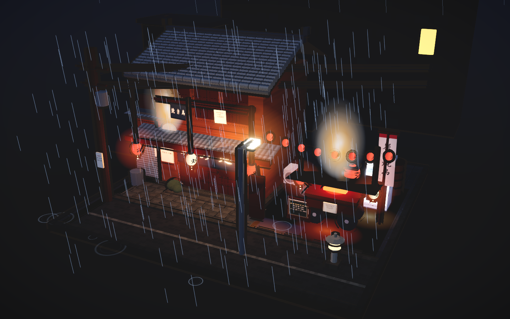

# web3d-kit

A small, opinionated toolkit for building **miniature diorama scenes** on the web: a ready render pipeline,
procedural texture library, block registry and objective self-check scripts. The kit is genre-agnostic;
scenes are assembled from blocks on top of a strict baseline. square miniature
street corners you can drag, rotate and zoom, exported as **one single-file HTML page** that runs
offline with no CDN and no server.

Born from a simple goal: stop rebuilding the same render pipeline, the same procedural textures and
the same 30 street props for every scene. The kit ships the reusable half; a scene only declares its
own geometry.

```
npm install          # three + postprocessing + esbuild
npm run assets       # fetch CC0 source assets (optional; the example needs none)
npm run build        # per scene: scenes/<name>/build/  ->  dist/<scene>.html (single file)
```

Open the produced HTML by double-clicking it. Drag to orbit, wheel to zoom.



---

## What's in the box

```
kit/lib/
  pipeline.js     one call builds the whole render stack (see below)
  engine.js       geometry buckets + merge, inverted-hull outline, lights, rain, ripples, steam, camera
  art.js          procedural texture atlas (canvas-drawn: wood, tile, plaster, paper, posters, glass…)
scenes/izakaya-yokocho/
  src/shops.js    the only file a new scene really has to write: assembly + props
  src/main.js     6 lines — declares the scene list and hands it to the kit
  build/          esbuild bundler (three + postprocessing inlined)
  test/           objective self-check scripts
kit/blocks/
  registry.js     block registry + assembly: a scene is a LIST of blocks, and each block carries a
                  round (1 geometry / 2 procedural textures / 3 shaders & post) so it can be staged
docs/             teardowns + notes: reference-work analysis, mechanisms, comparable open-source projects
scripts/fetch-assets.mjs   one-command asset restore with sha256 verification
```

### The pipeline preset

```js
import { createWetNightApp } from '<kit>/lib/pipeline.js';
const app = createWetNightApp({ canvas, shops, env: {...}, post: {...} });
window.__shop = app.api;      // show / stats / parts / project / setPose / toggleBloom
```

Chained automatically: PMREM environment lighting → inverted-hull toon outline → planar reflection on
the wet ground → bloom → ACES tone mapping → brightness/contrast grading → vignette → SMAA.
Everything is parameterised via the `env` / `post` options, so a scene stays declarative.

### Procedural-first

The example scene has **no textures on disk**: every surface — roof tiles, board siding, plaster,
paper lanterns, menus, posters, glass, wet asphalt — is painted into a canvas atlas at runtime. That
keeps the output a single file. Real PBR/HDRI sources are available through the asset script when a
scene wants them.

### Objective self-checks (not vibes)

The `test/` scripts drive a headless browser and assert on numbers, so regressions are caught without
a human looking at a picture:

| script | what it asserts |
| --- | --- |
| `test/shots.mjs` | page errors, console errors, per-frame stats, screenshot |
| `test/frame-check.mjs` | projected landmarks stay inside the canvas (nothing off-frame) |
| `test/look-check.mjs` | brightness histogram: mean / p25 / p50 / p75, dead-black ratio, blown ratio, fps |
| `test/fit-audit.mjs` | part bounding boxes: nothing floating, intended overlaps whitelisted |
| `test/effects.mjs` | each effect (rain, ripples, steam…) measurably changes pixels — no dead code |
| `test/compliance.mjs` | no external requests, links or inline handlers (single-file guarantee) |

### Staged rounds (geometry -> textures -> shaders)

Every artefact can be opened in three stages, so each layer can be judged on its own before the next
one is added. Append `?step=` to the URL, or use the `step` option of the app:

| step | what you see |
| --- | --- |
| `?step=1` | geometry and layout only (flat colours, no textures, no post) |
| `?step=2` | + procedural canvas textures and toon outline |
| `?step=3` | + shaders and post-processing (default) |

Blocks declare their round in `kit/blocks/registry.js`; `placeBlocks()` skips any block whose round is
above the current step. `scenes/*/test/rounds.mjs` opens all three steps and reports errors, triangles,
mean brightness, blown and dead pixel ratios for each.

### Assets without committing assets

`assets.lock.json` lists *where to get* things (Poly Haven HDRI, ambientCG PBR sets…) with purpose and
a sha256. `scripts/fetch-assets.mjs` re-downloads and verifies, and writes the checksum back on first
fetch. Nothing large ever enters git history, and a fresh clone can restore the same bytes:

```
node scripts/fetch-assets.mjs               # download missing + verify
node scripts/fetch-assets.mjs --verify-only # CI: verify only
node scripts/fetch-assets.mjs --only paving-stones-131
```

---

## Roadmap

- swap the planar `Reflector` for three's `SSRPass` (screen-space reflections) for correct grazing angles
- add `GTAOPass` ambient occlusion and `LUTPass` grading
- extract more scenes (shrine path, alley of shutters, riverside) from the same component set

## License

Code: MIT. Fetched assets: CC0 (Poly Haven, ambientCG) — see each entry in `assets.lock.json`.

---

## 中文速览

雨夜微缩街景工具箱：一条命令搭好整套渲染管线（环境光 → 三渲二描边 → 湿地面平面反射 →
泛光/ACES 调色/暗角/抗锯齿），另带程序化贴图库、构件库、一个可直接双击打开的示例场景
（日式雨夜横丁 · 居酒屋），以及一组**用数字断言**的自检脚本（构图不出画、画面不糊、特效不是摆设、
零外链）。素材走 `assets.lock.json` + 重下脚本，仓库不存素材本体。
```
npm install && npm run assets && npm run build
```
